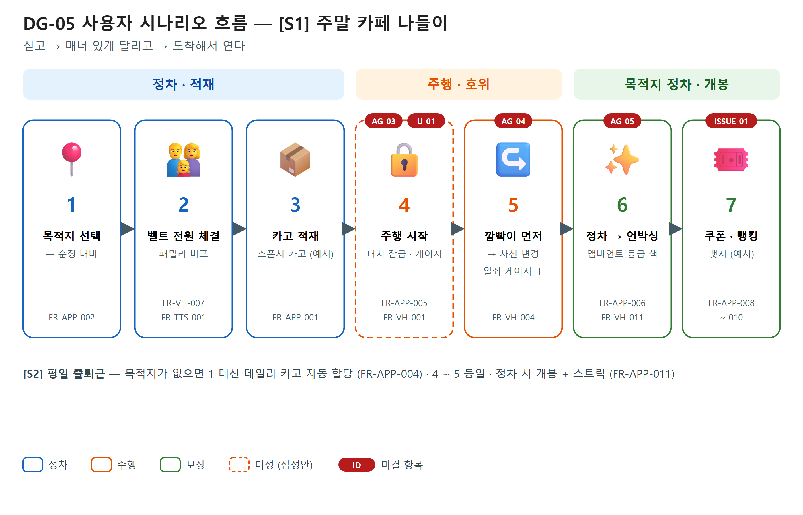
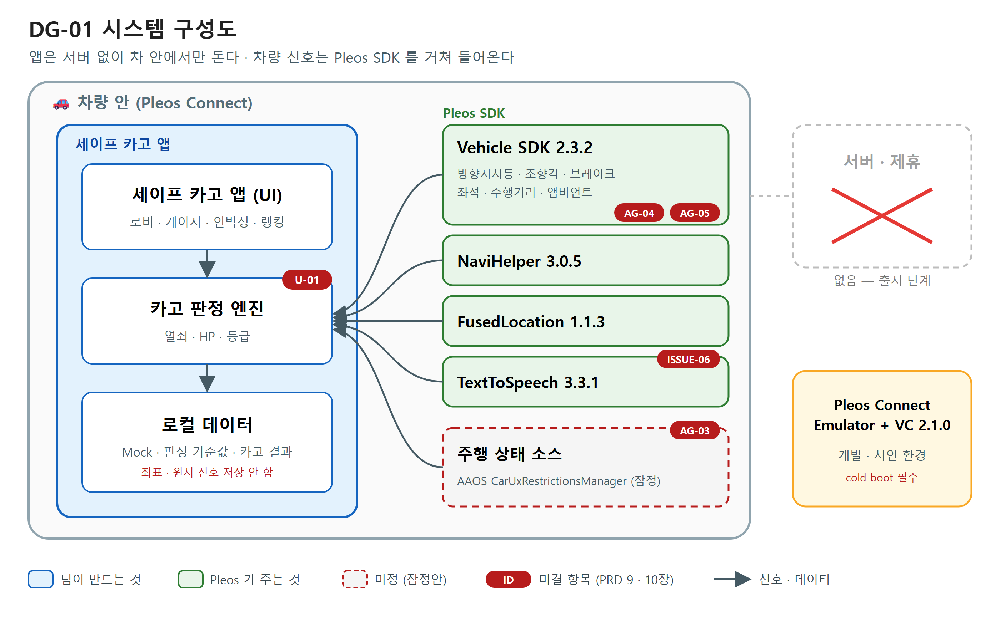
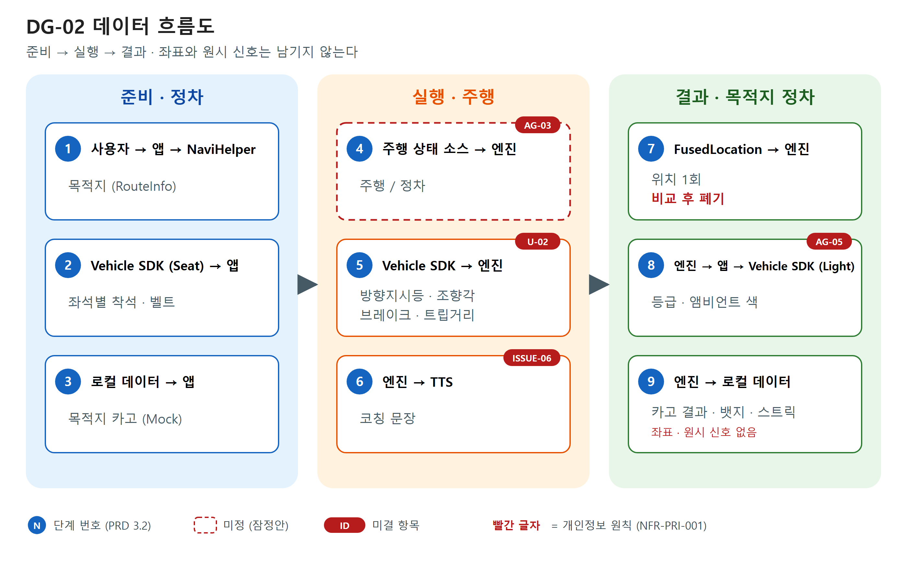
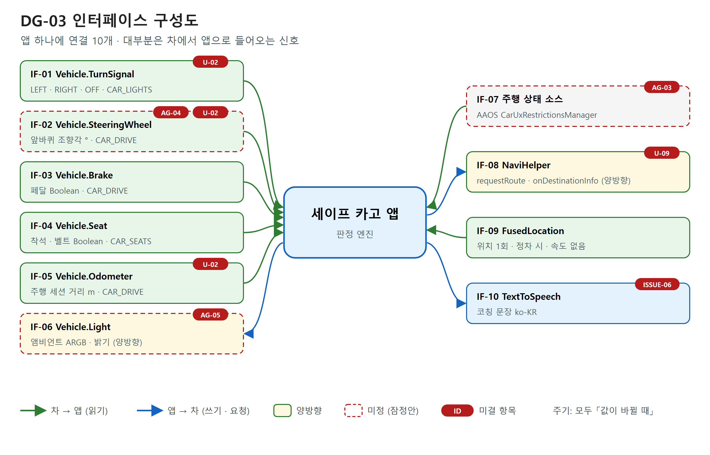
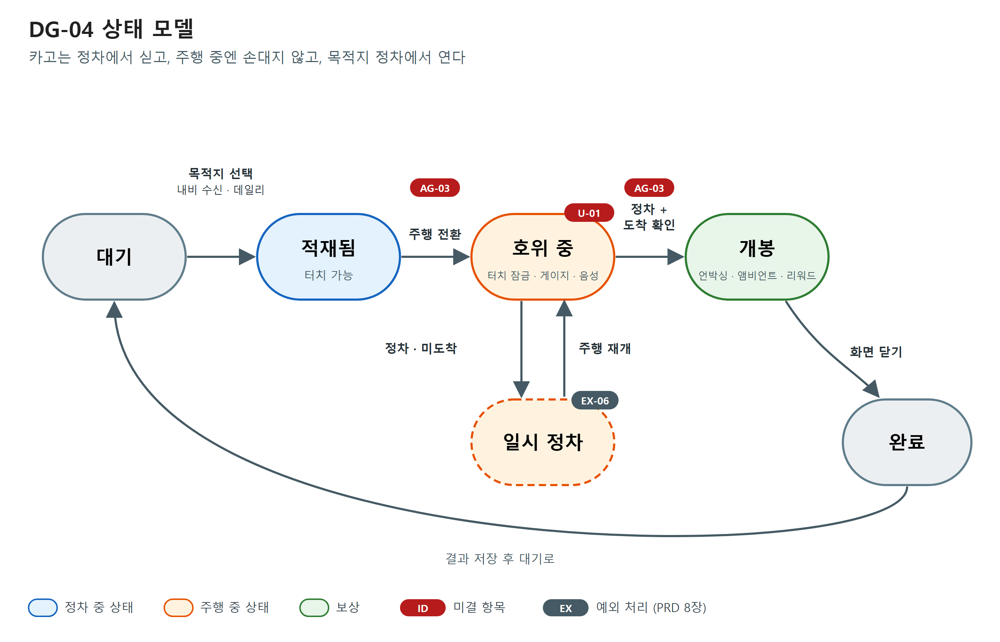
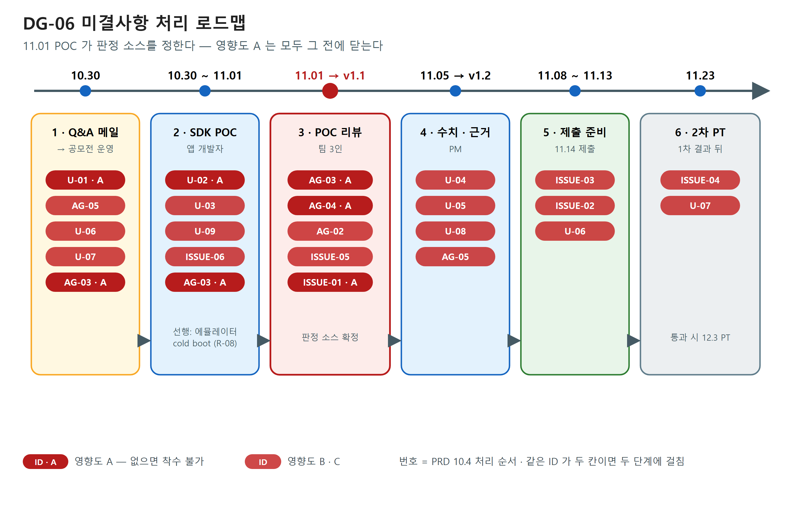

# 0. 문서 정보

## 0.1 문서 목적

이 PRD 는 Pleos Connect 차량용 앱 『세이프 카고』의 제출본(1차 서류 · 11.15 마감)과 2차 PT 동작 앱의 요구사항을 정의한다.
팀 마스터 기획서(SRC-01)를 공모 요강(SRC-02 · SRC-03)과 Pleos 공식 SDK 문서(SRC-04)에 대조해, 사실로 확인된 것과 아직 정해지지 않은 것을 나눠 적는다.
화면설계서 · 접수양식 원고 · 시연 영상 대본 · GitHub README 는 이 문서를 입력으로 쓴다.

## 0.2 입력 자료 대장

| SRC | 유형 | 문서명 | 버전·일자 | 작성 주체 | 원문 보관 | 반영 버전 |
|---|---|---|---|---|---|---|
| SRC-01 | 서비스 기능 요구사항 | 현대자동차그룹 차량용 앱 개발 공모전 최종 마스터 기획서 | v4.8 (26.10.29) | PM | sources/SRC-01_마스터기획서_v4.8.md | v1.0 |
| SRC-02 | 계약·협약·SOW | 공모전 공식 사이트 — 소개 · 참가 가이드 · 공지 · FAQ (appdevchallenge.auto-hmg.io) | 26.10.29 열람 | 공모전 운영 | sources/SRC-02_공모전사이트_요강.md | v1.0 |
| SRC-03 | 계약·협약·SOW | 공모전 접수양식 · 개인정보 수집·이용 동의서 (DOCX) | 동의서 1020 ver. | 공모전 운영 | sources/SRC-03_공식접수양식.md | v1.0 |
| SRC-04 | 기타 | Pleos Connect SDK 공식 문서 (document.pleos.ai/docs/pleos-only/connect-sdk-pleos/ 전체 + 개발 환경 · 주행 제한 가이드) | 26.10.29 열람 · Vehicle 2.3.2 | Pleos (현대자동차그룹) | sources/SRC-04_Pleos_SDK_공식문서.md | v1.0 |

## 0.3 용어 정의

| 용어 | 정의 |
|---|---|
| 카고 (Cargo) | 목적지까지 「싣고 가는」 가상 보물상자. 목적지 · 스폰서마다 위트 있는 이름이 붙는다 (예: 순두부 젤라또 카고) — SRC-01 ③ |
| 3대 열쇠 | 카고 봉인을 푸는 매너 운전 판정 3종 — 선행 깜빡이 · 부드러운 조향 · 패밀리 세이프티 버프 (4장) |
| 카고 무결성 (HP) | 급조향 · 깜빡이 없는 조향 때 깎이는 카고 상태값. 등급 산정에 쓴다 |
| 열쇠 게이지 (Key) | 매너 운전으로 쌓이는 값. 등급 산정에 쓴다 |
| 패밀리 버프 | 탑승한 좌석 전부 벨트를 맸을 때 열쇠 충전 · 리워드를 높이는 효과 |
| 등급 | 개봉 시 정해지는 상자 등급 (레전더리 · 에픽 · 레어 — 잠정). 상자는 항상 열리고 등급만 다르다 |
| 정차 · 주행 | 기획서의 「P단 · D단」. Vehicle SDK 에 기어 API 가 없어 판정 수단이 미정이다 (AG-03) — 이 문서는 「정차 · 주행」으로 쓴다 |
| DO (Distraction Optimization) | 주행 중 화면 제한 정책. 「DO 미선언 시 Parking 사용 가능 / Drive 사용 불가」 (SRC-04 §7) |
| VC (Virtual Console) | Pleos Connect Emulator 의 차량 신호 조작 도구 (v2.1.0) — 시연 영상의 우측 화면 |
| Mock 데이터 | 서버 없이 기기 안 JSON 으로 넣은 스폰서 · 쿠폰 · 랭킹 · 뱃지 시연용 데이터 |

## 0.4 개정 이력

| 버전 | 일자 | 작성자 | 변경 유형 | 주요 변경 | 근거 |
|---|---|---|---|---|---|
| v1.0 | 2026-10-29 | PM | 초안 | 초안 작성 — 입력 자료 4종 반영, 결정 6 · 협의 5 (확정 1) · 검토 9 식별. 기획서 v4.8 전제 중 기어 API · 조향각 의미 · 위치 속도 3건이 공식 문서와 달라 협의 · 결정으로 올림 | SRC-01 ~ SRC-04 |

## 0.5 표기 규칙

| 표기 | 색 | 뜻 |
|---|---|---|
| **[PM 의견]** · **[PM 판단]** · **[PM 권고]** | 노랑 | 작성자의 해석·권고. 사실이 아니라 의견이다 |
| **[ISSUE-NN 결정 필요]** · **[AG-NN 협의 필요]** · **[U-NN 검토 중]** | 빨강 | 아직 정해지지 않았다. 적힌 값은 **잠정안**이다 |
| **[vX.Y 확정]** · **[vX.Y 신규]** | 초록 | 그 버전에서 확정·추가됐다 |
| **[vX.Y 정정]** · **[vX.Y 변경]** | 파랑 | 그 버전에서 바뀌었다 — AS-IS → TO-BE 와 사유를 함께 적는다 |
| **[ISSUE-NN 보류]** · **[AG-NN 보류]** · **[U-NN 보류]** | 회색 | 사업 이관 · 중단으로 멈췄다. 재개 조건을 함께 적는다 |

미결 항목의 상태는 **열림 → 진행 중 → 부분 확정 → 확정 / 종결 / 이관** 으로만 쓴다.

값의 성격 (기입 양식 P5): ① SDK · 개발 환경 조건은 SRC-04 로 확정, 문서에 없으면 검토(U) ② 스폰서 · 쿠폰 · 랭킹 · 카고 이름 · 금액은 **화면 예시 (Mock)** — 검토 항목을 만들지 않는다 ③ 판정 수치는 **잠정값** (U-04) ④ BM 배분 · MAU · 리텐션은 **(제안)**.

# 1. 프로젝트 개요

## 1.1 프로젝트명

세이프 카고 (Safe Cargo : 해금의 여정) (약칭: 세이프카고) — 현대자동차그룹 차량용 앱 개발 공모전 「Code your App into Pleos App Market」 출품작.

## 1.2 배경 및 문제 정의

- 모바일 내비 · 커넥티드 서비스의 안전운전 점수는 주로 급가속 · 급감속 · 운행 시간대를 본다. 도로 위 갈등의 큰 원인인 **방향지시등 없는 차선 변경**과 **급격한 조향**은 보상 체계에서 다뤄지지 않는다 (SRC-01 ②-1).
- 점수는 운전자를 평가할 뿐 오늘 운전할 이유를 주지 않는다. 보상이 1년 단위 보험료 할인이라 오늘의 출퇴근길 · 나들이길에 매너 운전을 할 즉각적 동기가 없다 (SRC-01 ②-1).
- 방향지시등 · 조향 · 브레이크 · 좌석 벨트 신호는 차량에서만 얻을 수 있다 — 스마트폰은 알 수 없다 (SRC-01 ②-2, SRC-04 §2).

> **[U-08 검토 중]** 블루링크 · 기아 커넥트 「안전운전 점수」 항목은 언론 보도 기준으로 적었다 (SRC-01 Q0). 실제 앱 화면으로 재확인한다 — 확정 주체 PM, 회신 기한 11.05 (⑥ 원고 완성 전).

## 1.3 비즈니스 목표

1. **1차 서류 심사 통과** — 공식 접수양식 + 가산점 산출물(시연 영상 · GitHub 저장소 · release APK) 전부 제출 (SRC-01 머리말, SRC-02 §3).
2. **2차 PT 수상** — PT(12.3~4) 전까지 실제 동작하는 앱 완성 (SRC-02 §3 「2차 PT 심사 대상 팀은 PT 심사 전까지 실제 동작 가능한 앱 개발을 완료」).
3. **서비스 목표** — 「깜빡이 먼저 · 부드러운 조향 · 전 좌석 벨트」를 차량 신호로 판정해 오늘 도착한 장소에서 즉시 보상한다 (SRC-01 ②, ③).

심사 기준 4개 (배점 비공개 — SRC-02 §4) 와 이 PRD 의 대응:

| 심사 기준 | 주요 평가 내용 (SRC-02) | 대응 |
|---|---|---|
| 차량특화성 | 모바일 대비 차량 환경만의 가치, 주행·정차 맥락 | 차량 신호 판정 (6.2) · 정차 시 개봉 · 앰비언트 (FR-VH-011) |
| 창의성 | Pain Point 정의 및 해결 방식 | 평가가 아닌 「오늘의 미션」 · 목적지 보상 (1.2, 2.2) |
| 기술 활용성 | Pleos SDK·API 를 핵심 기능에 적절히 활용 | Vehicle 6개 도메인 + NaviHelper + FusedLocation + TTS (3.3) |
| 사업성 | 타깃 명확성, 예상 MAU, Retention | 1.4 · 접수양식 6 원고 (FR-SUB-001) |

## 1.4 핵심 성공 지표 (KPI)

| 구분 | 지표 | 목표 | 측정 방법 | 출처 |
|---|---|---|---|---|
| 공모전 | 1차 서류 통과 | 통과 (11.23 발표) | 공지 | SRC-02 §1 |
| 공모전 | 가산점 산출물 제출 | 시연 영상 · GitHub · release APK 3종 전부 | 제출 메일 | SRC-02 §3 |
| 공모전 | 시연 시나리오 구동 | 클린 에뮬레이터에서 S1 시나리오 끝까지 구동 | 제출 전 리허설 (11.13~15) | SRC-01 PART 5 |
| 출시 후 (제안) | 예상 MAU | 산식: 탑재 차량 수 × 설치율 × 월간 활성률 — 예시 10만 대 × 15% × 50% = 7,500 | 앱마켓 통계 | SRC-01 ⑥-2 |
| 출시 후 (제안) | 리텐션 | W1 40% · W4 25% · DAU/MAU 30% | 앱 로그 (익명) | SRC-01 ⑥-2 |

> **[U-05 검토 중]** 출시 후 지표는 (제안)이다 — 연도별 Pleos 탑재 대수와 리텐션 비교 자료가 없다 (SRC-01 ⑥-2 ⚠️). 확정 주체 PM, 회신 기한 11.05 (접수양식 6 원고 완성 전). 근거를 못 찾으면 산식과 「보수적 예시」 표기로만 낸다.

## 1.5 범위 (Scope)

### 1.5.1 In-Scope (1차)

- 3단계 단일 루프 앱 — 적재(정차) → 호위(주행) → 개봉(목적지 정차) — 6.1 FR-APP-001 ~
- 차량 신호 판정 엔진 (3대 열쇠 · 등급) — 6.2 FR-VH-001 ~ , 4장
- 정차 시 1회 위치 도착 확인 — 6.3 FR-LOC-001
- 음성 코칭 — 6.4 FR-TTS-001
- 기기 안 Mock 데이터 (스폰서 · 카고 · 쿠폰 · 랭킹 · 뱃지) · 판정 기준값 설정 파일 — 6.5 FR-DATA-001 ~
- 제출물 (접수양식 1~8 · 시연 영상 · GitHub + release APK · 동의서) — 6.6 FR-SUB-001 ~
- 2차 PT 전 실제 동작 앱 (서류 통과 시) — FR-SUB-007

> **[ISSUE-04 결정 필요]** 2차 PT 까지의 고도화 범위 — 잠정안: Mock 유지 + 완성도 향상. 결정권자 PM, 결정 시점 11.23 (1차 결과 발표).

### 1.5.2 Out-of-Scope (2차 이후 검토)

- 서버 (스폰서 관리 · 쿠폰 발급 · 랭킹 서버 · 계정) — 개발자 1명 · 18일 범위. 출시 단계 계획으로만 접수양식 6 에 쓴다 (SRC-01 0.1)
- 제휴 연동 (현대Shop · 블루멤버스 · Pleos 포인트 · 유료 앱 결제) — 확인된 제휴 없음, (제안)으로만 표기 (SRC-01 0.1)
- 보험사 UBI 연동 — 블루링크 · 현대해상 특약 재구현으로 읽힘 (SRC-01 0.1)
- 카메라 AR — SDK 에 카메라 영상 API 없음 (SRC-01 1.1)
- 실시간 커뮤니티 게시판 · 채팅 — 주행 안전 (SRC-01 1.1)
- 인앱 쇼핑몰 화면 (SRC-01 1.1)
- 관리자 화면 (기입 양식 P4)
- 숏폼 챌린지 영상 — ISSUE-03 결정 전 잠정 제외

> **[U-07 검토 중]** 외부 서버 · 로그인 정책은 SRC-04 에 없다. 출시 단계 서버 설계 전에 공모전 운영에 확인한다 — 확정 주체 공모전 운영, 회신 기한 11.23. 제출본은 서버가 없어 영향 없음.

## 1.6 사업 추진 조건

| 구분 | 내용 | 근거 / 시점 |
|---|---|---|
| 성격 | 사이드 프로젝트 · 공모전 출품 (계약 없음 — 내부 과제) | 기입 양식 P3 |
| 부문 · 팀 | 일반 부문 (가정 — 접수양식 A 에 표기) · 3인 (PM · 디자이너 · 앱 개발자) | SRC-01 머리말 · SRC-02 §2 (최대 5인) |
| 접수 마감 | 2026.11.15(일) 23:59 · 팀 목표 11.14(토) 제출 | SRC-03 · SRC-01 PART 5 |
| 1차 결과 | 11.23(월) | SRC-02 §1 |
| 2차 PT | 12.3 ~ 12.4 오프라인 (서류 통과 20팀) | SRC-02 §1 |
| 최종 발표 · 전시 | 12.18 발표 · 2027.2 전시 · 시상 (최종 10팀은 구동용 APK 필수) | SRC-02 §1 · §3 |
| 마일스톤 | Step 1 ~11.01 스펙 확정 · SDK POC / Step 2 ~11.05 GUI · 코어 엔진 / Step 3 ~11.08 알파 APK / Step 4 ~11.12 영상 · 최종본 / Step 5 ~11.15 제출 | SRC-01 PART 5 |
| 지재권 | 참가자 귀속 · 주최 측 비독점 이용권 · 수상 아이디어 우선 협상권 (발표 후 4개월) | SRC-02 §6 |
| 상금 | 대상 1,000만원 등 · 대표자 일괄 지급 · 원천징수 | SRC-02 §6 |

## 1.7 유관 조직 · 결정권자

| 조직 | 역할 | 관할 (무엇을 정하나) | 결정권자 | 부재 시 대리 | 창구 | 출처 |
|---|---|---|---|---|---|---|
| PM | 요구 주체 · 결정 | 범위 · 기획 · 판정 규칙 · 제출물 · 랭킹 방향 · 일정 | PM | 디자이너 | PM | 기입 양식 M9 |
| 디자이너 | 개발 · 결정 | 화면 · UX · 카고 에셋 · 앰비언트 색 · 시연 영상 편집 | 디자이너 | PM | 디자이너 | 기입 양식 M9 |
| 앱 개발자 | 개발 · 결정 | SDK 연동 · 판정 엔진 구현 · 기술 가능 여부 · TTS 모드 · APK | 앱 개발자 | PM | 앱 개발자 | 기입 양식 M9 |
| 공모전 운영 | 협의 · 운영 | 퍼미션 승인 · 주행 중 제한(DO) 정책 · 공모 규정 해석 · Q&A 회신 | 공모전 운영 | Pleos 공식 문서 (공식 답변 전 기준) | appdevchallenge@hyundai-partners.com | SRC-02 · SRC-03 |

> 사람은 역할명으로만 쓴다 — 접수양식 02 장 성명·소속 기재 금지, 첨부 자료에도 실명 노출 금지 (SRC-03).

# 2. 사용자 정의 및 시나리오

## 2.1 페르소나

### [P1] 일상 통근자 (나이 미기입, 직장인) — 주 사용자

| 항목 | 내용 |
|---|---|
| 역할 | 혼자 출퇴근하는 운전자 (주 5일) |
| 사용 환경 | Pleos Connect 탑재 차량. 목적지 없이 익숙한 길을 운전하는 날이 많다 |
| 페인포인트 | 지루한 출퇴근길에 매너 운전을 할 즉각적 이유가 없다 |
| 기대 가치 | 매너 운전만으로 커피값 · 차량용품 포인트를 모은다 (SRC-01 ⑥-1) |

### [P2] 주말 나들이 가족 운전자 (나이 미기입) — 주 사용자

| 항목 | 내용 |
|---|---|
| 역할 | 가족과 관광지 · 휴게소 · 대형 카페로 이동 (주 1~2회) |
| 사용 환경 | 1·2열 동승자 탑승, 내비 목적지 설정 |
| 페인포인트 | 동승자 안전벨트 확인 · 아이와의 이동이 지루함 |
| 기대 가치 | 아이와 함께 「보물상자 언박싱」과 현장 할인 혜택 (SRC-01 ⑥-1) |

보조 사용자: 동승자 — 벨트 체결로 패밀리 버프에 참여한다 (SRC-01 ③ Step 2).

## 2.2 핵심 사용자 시나리오

### [S1] 주말 카페 나들이 (P2, 차량 앱) — 시연 영상 기본 시나리오

1. 정차 상태에서 앱을 열고 목적지(예시: 파주 베이커리 카페)를 고른다 → 순정 내비로 안내가 넘어간다 — FR-APP-002
2. 1·2열 3명 착석 · 벨트 체결이 감지되면 「패밀리 버프」 배지와 음성 안내 — FR-VH-007, FR-TTS-001
3. 목적지 스폰서 카고(예시: 바리스타의 수제 타르트 상자)가 가상 트렁크에 적재된다 — FR-APP-001
4. 주행이 시작되면 화면이 게이지 모드로 바뀌고 터치가 잠긴다 — FR-APP-005, FR-VH-001
5. 깜빡이를 먼저 켜고 차선을 바꾸면 차임과 함께 열쇠 게이지가 오른다 — FR-VH-004
6. 목적지 주차장에서 정차하면 언박싱 화면이 자동으로 뜨고 앰비언트 조명이 등급 색으로 빛난다 — FR-APP-006, FR-VH-011
7. 쿠폰 · 포인트 카드(예시)와 랭킹 · 뱃지를 확인한다 — FR-APP-008 ~ 010

### [S2] 평일 출퇴근 (P1, 차량 앱)

1. 목적지 없이 출발하면 「데일리 출퇴근 카고」(예시: 부장님의 결재판 카고)가 자동 할당된다 — FR-APP-004
2. 주행 · 판정은 S1 의 4 ~ 5 와 같다
3. 정차 시 개봉, 연속 무결점 호위 스트릭이 누적된다 — FR-APP-011

# 3. 시스템 구조 및 인터페이스

## 3.1 시스템 구성

| 구성 요소 | 소유 조직 | 주요 역할 | 주요 기술 요소 | 출처 |
|---|---|---|---|---|
| 세이프 카고 앱 (UI) | 앱 개발자 · 디자이너 | 적재 로비 · 주행 게이지 · 언박싱 · 랭킹 화면 | Android (AAOS) · Kotlin · Lottie | SRC-01 ⑤ |
| 카고 판정 엔진 | 앱 개발자 | 차량 신호 → 열쇠 · HP · 등급 산정 | Foreground Service (잠정 — U-01) | SRC-01 ⑤-2 |
| 로컬 데이터 | 앱 개발자 | Mock 스폰서 · 카고 · 쿠폰 · 랭킹 · 뱃지, 판정 기준값, 카고 결과 | Room / JSON | SRC-01 ⑤-1 |
| Vehicle SDK 2.3.2 | Pleos (공모전 운영) | 방향지시등 · 조향각 · 브레이크 · 좌석 · 주행거리 · 앰비언트 | `ai.pleos.playground:Vehicle:2.3.2` | SRC-04 §1 · §2 |
| NaviHelper 3.0.5 | Pleos (공모전 운영) | 목적지 전달 · 순정 내비 목적지 수신 | `ai.pleos.playground:NaviHelper:3.0.5` | SRC-04 §4 |
| FusedLocation 1.1.3 | Pleos (공모전 운영) | 정차 시 1회 위치 | `ai.pleos.playground:FusedLocation:1.1.3` | SRC-04 §6 |
| TextToSpeech 3.3.1 | Pleos (공모전 운영) | 음성 코칭 | `ai.pleos.playground:TextToSpeech:3.3.1` | SRC-04 §5 |
| 주행 상태 소스 | AAOS (공모전 운영) | 주행 · 정차 판정 | `CarUxRestrictionsManager` (잠정 — AG-03) | SRC-04 §7 |
| Pleos Connect Emulator + VC 2.1.0 | Pleos | 개발 · 시연 환경 | API 34 이미지 · cold boot | SRC-04 §1 |

## 3.2 데이터 흐름

| 단계 | 구분 | From → To | 주요 데이터 | 통신 방식 | 출처 |
|---|---|---|---|---|---|
| 1 | 준비 | 사용자 → 앱 → NaviHelper | 목적지 (RouteInfo) | SDK IPC | SRC-04 §4 |
| 2 | 준비 | Vehicle SDK (Seat) → 앱 | 좌석별 착석 · 벨트 (Boolean) | SDK 콜백 | SRC-04 §2 |
| 3 | 준비 | 로컬 데이터 → 앱 | 목적지 카고 (Mock) | 기기 내부 | SRC-01 ⑤-1 |
| 4 | 실행 | 주행 상태 소스 → 엔진 | 주행 / 정차 | 콜백 (잠정 AG-03) | SRC-04 §7 |
| 5 | 실행 | Vehicle SDK → 엔진 | 방향지시등 · 조향각 · 브레이크 · 트립거리 | SDK 콜백 (값 변경 시) | SRC-04 §2 |
| 6 | 실행 | 엔진 → TTS | 코칭 문장 | SDK | SRC-04 §5 |
| 7 | 결과 | FusedLocation → 엔진 | 위치 1회 (비교 후 폐기) | SDK 1회 조회 | SRC-01 ③ Step 3 · SRC-04 §6 |
| 8 | 결과 | 엔진 → 앱 → Vehicle SDK (Light) | 등급 · 앰비언트 색 (ARGB) | SDK set | SRC-04 §2 |
| 9 | 결과 | 엔진 → 로컬 데이터 | 카고 결과 · 뱃지 · 스트릭 (원시 신호 · 좌표 없음) | 기기 내부 | SRC-01 Q0 |

## 3.3 인터페이스 정의

| IF | 구간 | 프로토콜 | 방향 | 전송 내용 | 주기·트리거 | 상태 |
|---|---|---|---|---|---|---|
| IF-01 | 앱 ↔ Vehicle.TurnSignal | SDK IPC (`registerTurnSignalState`) · CAR_LIGHTS | 차량 → 앱 | `TurnSignalValue {OFF, RIGHT, LEFT}` | 값 변경 시 (주기 미기재 — U-02) | 확정 |
| IF-02 | 앱 ↔ Vehicle.SteeringWheel | SDK IPC (`registerSteeringWheelAngle`) · CAR_DRIVE | 차량 → 앱 | 앞바퀴 조향각 `Float?` ° (좌 음수) | 값 변경 시 (U-02) | 확정 (판정 기준 AG-04) |
| IF-03 | 앱 ↔ Vehicle.Brake | SDK IPC (`registerBrakePedalStatus`) · CAR_DRIVE | 차량 → 앱 | 페달 `Boolean?` | 값 변경 시 | 확정 |
| IF-04 | 앱 ↔ Vehicle.Seat | SDK IPC (`registerSeatOccupancy` · `registerSeatBeltBuckledState`) · CAR_SEATS | 차량 → 앱 | 좌석 영역별 착석 · 벨트 `Boolean?` | 값 변경 시 | 확정 |
| IF-05 | 앱 ↔ Vehicle.Odometer | SDK IPC (`registerTripCurrentDrivingDistance`) · CAR_DRIVE | 차량 → 앱 | 주행 세션 거리 `Float?` m | 값 변경 시 (U-02) | 확정 |
| IF-06 | 앱 ↔ Vehicle.Light | SDK IPC (`get/setAmbientLightBrightnessColor` · `setAmbientLightBrightness`) | 양방향 | 32-bit ARGB · 밝기 | 개봉 시 1회 + 원복 | AG-05 |
| IF-07 | 앱 ↔ 주행 상태 소스 | AAOS `CarUxRestrictionsManager` (잠정) | 차량 → 앱 | 주행 제한 상태 | 상태 변경 시 | AG-03 |
| IF-08 | 앱 ↔ NaviHelper | SDK (`requestRoute` · `onDestinationInfo`) · NAVI_ROUTE | 양방향 | 목적지 (lat/lng/name/poiId) | 목적지 선택 · 변경 시 | 확정 (에뮬레이터 동작 U-09) |
| IF-09 | 앱 ↔ FusedLocation | SDK (`getLastKnownLocation`) · FUSED_LOCATION (dangerous) | 차량 → 앱 | 위도 · 경도 (속도 없음) | 목적지 정차 시 1회 | 확정 |
| IF-10 | 앱 ↔ TextToSpeech | SDK (`speak`) · TTS_SERVICE | 앱 → 차량 | 코칭 문장 (ko-KR) | 판정 이벤트 시 | ISSUE-06 |

## 3.4 HW 개발 사양 연계

### 3.4.1 문서 관계

| 문서 | 관할 | 정의 범위 | 본 PRD 와의 관계 |
|---|---|---|---|
| SRC-04 Pleos Connect SDK 문서 | Pleos | 차량 신호 API · 퍼미션 · 값 형식 · 개발 환경 | 사실의 정본. 기획서(SRC-01)와 다르면 고르지 않고 협의(AG)로 올린다 |
| SRC-02 · SRC-03 공모 요강 | 공모전 운영 | 제출물 · 심사 · 일정 · 익명 규정 | 범위 · 제출물 요구의 근거 |
| SRC-01 마스터 기획서 v4.8 | PM | 서비스 컨셉 · 판정 · 시나리오 · BM | 요구의 출처 |

### 3.4.2 HW 특성에 따른 서비스 설계 원칙

| 원칙 | HW 근거 | 서비스 측 반영 |
|---|---|---|
| 판정은 「값이 바뀐 시각」 기준 | 콜백은 값 변경 시에만 오고 주기 미기재 (SRC-04 §2) | 이벤트 타임스탬프로 구간을 만들고, 정밀 시간 비교를 쓰지 않는다 (4장) |
| 조향 판정은 앞바퀴 각 기준 | 「does not represent the rotation angle of the steering wheel」 (SRC-04 §2) | 핸들각 전제(-540~540°)의 임계값을 쓰지 않는다 — AG-04 |
| 차종마다 지원이 다르다 | `checkXxxCapabilities` · `ERROR_NOT_SUPPORTED_*` (SRC-04 §2) | 도메인마다 먼저 확인하고, 미지원이면 해당 열쇠 · 연출만 끈다 (EX-01) |
| 차속이 없다 | Vehicle · FusedLocation 모두 속도 필드 없음 (SRC-04 §2 · §6) | 감속 판정은 ISSUE-05 결정 전까지 잠정안으로 |
| 비동기 · 해제 순서 | 「비동기 콜백이 끝나기 전에 release() 호출 금지」 (SRC-04 §2) | 리스너 해제 → 콜백 종료 확인 → release (FR-VH-013) |

## 3.5 통신 · 동기화 · 오프라인 정책

- 제출본은 서버와 통신하지 않는다. 모든 데이터는 기기 안에 있다 (SRC-01 0.1 · ⑤-1).
- TTS 를 ON_DEVICE 모드로 쓰면 네트워크가 필요 없다. HYBRID · SERVER 모드는 Playground 앱 등록(Client ID/Secret)이 필요하다 (SRC-04 §5) — ISSUE-06.
- 원시 주행 신호 · 좌표는 저장 · 전송하지 않는다. 카고 결과(등급 · 열쇠 · HP · 일자)만 저장한다 (SRC-01 Q0, ③ Step 3).

## 3.6 기존 설계와의 관계

해당 없음 — 기존 설계 없음 (기입 양식 P2).

# 4. 핵심 도메인 로직

판정은 기기 안에서만 하며, 수치는 모두 잠정값이다 (기입 양식 P5).

| 규칙 | 입력 | 잠정 판정 | 효과 (잠정) | 출처 |
|---|---|---|---|---|
| 제1열쇠 — 선행 깜빡이 | IF-01 · IF-02 | 깜빡이가 켜진 구간 안에서 차선 변경 조향이 일어나면 성공. 켠 뒤 조향까지 1.5초 이상이면 「퍼펙트 시그널」 | 성공 +30 Key · 차임 / 깜빡이 없는 조향은 HP 감소 · 금 가는 효과음 | SRC-01 ③ Step 2-1 |
| 제2열쇠 — 부드러운 조향 | IF-02 | 단위 시간당 조향각 변화율 \|Δθ/Δt\| 가 임계값을 넘지 않으면 HP 유지 | 초과 시 HP 감소 | SRC-01 ③ Step 2-2 |
| 제2열쇠 — 부드러운 감속 | IF-03 · (IF-05) | ISSUE-05 결정 전 잠정: 트립거리 변화로 속도를 추정해 브레이크 구간의 감속폭을 본다 | 부드러우면 HP 유지 | SRC-01 ③ Step 2-2 · SRC-04 §2 |
| 제3열쇠 — 패밀리 버프 | IF-04 | 착석한 모든 좌석의 벨트가 체결 | 열쇠 충전 · 최종 리워드 1.5배 | SRC-01 ③ Step 2-3 |
| 등급 | Key · HP · 버프 | 상자는 **항상** 열리고 등급만 다름 (레전더리 · 에픽 · 레어) | 앰비언트 색 · 리워드 | SRC-01 0.1 · ③ Step 3 |
| 스트릭 | 일자별 결과 | 연속 무결점 호위 5일 → 황금 카고 확정 | — | SRC-01 ⑥-2 |
| 도착 확인 | IF-09 | 정차 시 1회 위치와 목적지 좌표 거리 ≤ 반경 | 스폰서 카고 · 쿠폰 지급 | SRC-01 ③ Step 3 |

> **[AG-04 협의 필요]** 기획서는 조향각을 핸들 회전각(-540~540°, 1도 단위)으로 전제했으나 SDK 값은 **앞바퀴 각**이다 (SRC-01 ②-2 · ⑤-1 ↔ SRC-04 §2). 차선 변경 시 앞바퀴 각은 매우 작아 커브와 구분이 더 어렵다. 잠정안: 「깜빡이 구간 안의 조향 발생」만 기본 판정으로 쓰고 임계값은 VC 슬라이더 값 범위를 POC 에서 측정해 정한다 — 주관 PM · 앱 개발자, 목표 11.01.

> **[U-02 검토 중]** 조향각 · 트립거리 · 방향지시등 콜백 주기가 문서에 없다 (SRC-04 §2). 1.5초 기준과 변화율 계산의 근거다 — 확정 주체 앱 개발자 (POC 측정), 회신 기한 11.01.

> **[U-04 검토 중]** 판정 수치 (1.5초 · +30 Key · 변화율 임계 · 버프 1.5배 · 스트릭 5일 · 등급 구간 · 도착 반경)는 잠정값이다 — 확정 주체 PM (POC 결과 반영), 회신 기한 11.05 (코어 엔진 완성 전). 값은 설정 파일로 분리해 바꾼다 (FR-DATA-002).

> **[PM 의견]** 판정 오차로 「켰는데 밀렸다」는 불만을 막기 위해 한 번의 판정은 등급에만 반영하고, 랭킹은 누적 횟수 중심으로 한다 (SRC-01 0.3 ②).

# 5. 데이터 모델 및 상태 정의

## 5.1 핵심 엔티티

| 엔티티 | 주요 속성 | 화면 활용 |
|---|---|---|
| Sponsor (Mock) | id · 이름 · 유형(지자체 · 휴게소 · 카페 · 데일리) · 목적지 좌표 · 반경 | 적재 로비 스폰서 표시 |
| Cargo (Mock) | id · 이름 · 설명 문구 · 스폰서 id · 에셋 | 적재 연출 · 언박싱 |
| Trip | 시작 · 종료 일자 · 목적지(이름) · 카고 id · Key · HP · 버프 여부 · 등급 · 도착 확인 여부 (좌표 없음) | 결과 · 스트릭 |
| Reward (Mock) | 쿠폰 문구 · 금액(예시) · 포인트(예시) · QR | 리워드 카드 |
| Ranking (Mock) | 범위(ISSUE-01) · 순위 · 표시명 · 배달 카고 수 | 랭킹 보드 |
| Badge | id · 칭호 · 획득 조건 · 획득 일자 | 뱃지 컬렉션 |
| JudgeConfig | 판정 수치 전부 (U-04) | — (설정 파일) |

## 5.2 상태 모델

| 상태 | 의미 | 진입 조건 | UI 동작 규칙 |
|---|---|---|---|
| 대기 | 앱 실행 · 정차 · 카고 없음 | 앱 시작 / 개봉 완료 후 확인 | 목적지 선택 가능 |
| 적재됨 | 카고 탑재 · 정차 | 목적지 선택 · 순정 내비 목적지 수신 · 데일리 자동 할당 | 카고 · 버프 표시, 터치 가능 |
| 호위 중 | 주행 중 | 주행 상태 전환 (AG-03) | 터치 잠금 · 게이지 · 음성만 (U-01) |
| 일시 정차 | 주행 중 잠깐 멈춤 (신호 대기 등) | 정차 전환 + 목적지 미도착 | 게이지 유지 · 개봉하지 않음 (EX-06) |
| 개봉 | 목적지 도착 정차 | 정차 전환 + 도착 확인 (또는 데일리 카고 종료 조작) | 언박싱 · 앰비언트 · 리워드 · 랭킹 |
| 완료 | 결과 저장 | 개봉 화면 닫기 | 대기로 |

## 5.3 권한 모델

| 기능 영역 | 운전자 (P1 · P2) | 동승자 | 운영자 |
|---|---|---|---|
| 목적지 선택 · 카고 적재 | 정차 시 | 정차 시 | — (출시 단계) |
| 주행 중 화면 조작 | 불가 | 불가 | — |
| 개봉 · 리워드 · 랭킹 · 뱃지 | 정차 시 | 정차 시 | — |
| 스폰서 · 카고 등록 | — | — | 출시 단계 (Out-of-Scope) |

# 6. 상세 기능 요구사항

## 6.1 APP — 화면 · 흐름

| ID | 기능 | 요구사항 | 우선순위 | 출처 | 상태 |
|---|---|---|---|---|---|
| FR-APP-001 | 카고 적재 로비 | 정차 상태에서 오늘의 카고(이름 · 문구 · 스폰서 — 예시) · 목적지 · 버프 배지를 보여준다 | Must | SRC-01 ③ Step 1 | 확정 |
| FR-APP-002 | 목적지 선택 · 전달 | 앱에서 목적지(Mock 스폰서 목록)를 고르면 `requestRoute` 로 순정 내비에 안내를 넘긴다 | Must | SRC-01 ③ Step 1 · SRC-04 §4 | 확정 |
| FR-APP-003 | 순정 내비 목적지 수신 | `onDestinationInfo` 로 받은 목적지가 Mock 스폰서 반경 안이면 해당 카고를 자동 적재한다 | Should | SRC-04 §4 | 잠정 (U-09) |
| FR-APP-004 | 데일리 카고 | 목적지가 없으면 데일리 출퇴근 카고를 자동 할당한다 | Must | SRC-01 ③ Step 1 | 확정 |
| FR-APP-005 | 주행 모드 화면 | 주행 중에는 모든 터치 버튼을 비활성화하고 카고 HP · 열쇠 게이지만 표시한다. 다른 사용자와 겨루는 화면은 없다 | Must | SRC-01 ③ Step 2 · Q3 | 잠정 (U-01) |
| FR-APP-006 | 개봉 화면 자동 표시 | 목적지 도착 정차 시 언박싱 화면을 자동으로 띄운다 | Must | SRC-01 ③ Step 3 | 잠정 (AG-03) |
| FR-APP-007 | 언박싱 연출 | 상자는 항상 열리며 등급(레전더리 · 에픽 · 레어)별 Lottie 애니메이션을 재생한다 | Must | SRC-01 0.1 · PART 5 Step 2 | 확정 |
| FR-APP-008 | 리워드 카드 | 쿠폰(QR · 금액 — 예시) · 포인트(예시) 카드를 보여준다. 모든 금액 · 제휴명 옆에 「예시」를 표기한다 | Must | SRC-01 ③ Step 3 · PART 4 | 확정 |
| FR-APP-009 | 랭킹 보드 | 정차 시에만 랭킹(Mock)을 보여준다. 순위 기준은 운전 점수가 아니라 무사히 배달한 카고 수 · 등급이다 | Should | SRC-01 0.3 · ③ Step 3 | 잠정 (ISSUE-01) |
| FR-APP-010 | 뱃지 · 칭호 | 업적 달성 시 칭호(예: 깜빡이 성기사 · 무진동 쇼퍼)를 지급 · 수집한다 | Could | SRC-01 ③ Step 3 | 확정 |
| FR-APP-011 | 스트릭 | 연속 무결점 호위 일수를 표시하고 기준 달성 시 황금 카고를 확정 지급한다 | Could | SRC-01 ⑥-2 | 잠정 (U-04) |

> **[U-01 검토 중]** 「DO 미선언 시 Drive 사용 불가」와 `CarUxRestrictionsManager` 적용 방법은 확인됐다 (SRC-04 §7). DO **선언 방법 · 승인 필요 여부 · Foreground Service 유지 · 주행 중 TTS · 효과음 허용**은 문서에 없다. 잠정안: DO 를 선언하고 주행 중 화면은 게이지만 둔다 — 확정 주체 공모전 운영 (Q&A 메일), 회신 기한 11.01. 회신이 없으면 문서 기준 잠정안으로 개발한다.

> **[ISSUE-01 결정 필요]** 랭킹 방식 — 잠정안: 크루 랭킹 먼저, 동네 대항전으로 확장, 순위는 누적 배달 카고 수. 결정권자 PM, 11.01.

> **[U-09 검토 중]** `onDestinationInfo` 는 「Navigation 앱 구현·상태에 따라 달라질 수 있음」 (SRC-04 §4). 에뮬레이터에서 이벤트가 실제로 오는지 POC 에서 확인한다 — 확정 주체 앱 개발자, 회신 기한 11.01. 안 오면 FR-APP-002 만으로 시연한다.

## 6.2 VH — 차량 신호 · 판정

| ID | 기능 | 요구사항 | 우선순위 | 출처 | 상태 |
|---|---|---|---|---|---|
| FR-VH-001 | 주행 · 정차 판정 | 주행 · 정차 전환을 감지해 상태(5.2)를 바꾼다 | Must | SRC-01 ③ · SRC-04 §7 | 잠정 (AG-03) |
| FR-VH-002 | 방향지시등 구독 | `registerTurnSignalState` 로 LEFT · RIGHT · OFF 와 수신 시각을 기록한다 | Must | SRC-04 §2 | 확정 |
| FR-VH-003 | 조향각 구독 | `registerSteeringWheelAngle` 로 앞바퀴 조향각(°)과 수신 시각을 기록한다 | Must | SRC-04 §2 | 확정 |
| FR-VH-004 | 제1열쇠 판정 | 4장 「선행 깜빡이」 규칙으로 Key · HP · 효과음을 바꾼다 | Must | SRC-01 ③ Step 2-1 | 잠정 (AG-04) |
| FR-VH-005 | 제2열쇠 — 조향 | 4장 「부드러운 조향」 규칙으로 HP 를 바꾼다 | Must | SRC-01 ③ Step 2-2 | 잠정 (U-04) |
| FR-VH-006 | 제2열쇠 — 감속 | 4장 「부드러운 감속」 규칙 — 브레이크 페달(`Boolean`) 구독 포함 | Should | SRC-01 ③ Step 2-2 · SRC-04 §2 | 잠정 (ISSUE-05) |
| FR-VH-007 | 제3열쇠 — 패밀리 버프 | 좌석 영역별 착석 · 벨트를 구독해 착석 좌석 전부 체결이면 버프를 켠다 (CAR_SEATS) | Must | SRC-01 ③ Step 2-3 · SRC-04 §2 | 확정 |
| FR-VH-008 | 주행 거리 | `registerTripCurrentDrivingDistance` (m) 로 호위 거리를 누적 표시한다 | Should | SRC-01 ⑤-1 · SRC-04 §2 | 확정 |
| FR-VH-009 | 등급 산정 | Key · HP · 버프로 등급을 정한다. 상자는 항상 열린다 | Must | SRC-01 0.1 | 잠정 (U-04) |
| FR-VH-010 | Capability 확인 | 도메인마다 `checkXxxCapabilities` 로 지원을 확인하고 미지원이면 해당 기능 UI 를 끈다 | Must | SRC-04 §2 | 확정 |
| FR-VH-011 | 앰비언트 언박싱 | 적재 시 현재 앰비언트 색 · 밝기를 get 으로 저장 → 개봉 시 등급 색(ARGB)으로 3초 점등 → 저장값으로 원복 | Should | SRC-01 ③ Step 3 · SRC-04 §2 | 잠정 (AG-05) |
| FR-VH-012 | 조명 폴백 | 앰비언트 미지원 · 퍼미션 실패 시 화면 테두리 풀스크린 라이트 효과로 대신한다 | Must | SRC-01 ⑤-1 | 확정 |
| FR-VH-013 | 해제 | 앱 종료 시 모든 리스너를 해제하고, 비동기 콜백이 끝난 뒤 `release()` 한다 | Must | SRC-01 ⑤-2 · SRC-04 §2 | 확정 |

> **[AG-03 협의 필요]** Vehicle SDK 2.3.2 에 기어 API 가 없다 (SRC-01 ⑤-1 `getGear().registerGearSelection` ↔ SRC-04 §2 도메인 19개에 Gear 없음). 잠정안: 문서에 있는 `CarUxRestrictionsManager` 주행 제한 상태로 주행 · 정차를 판정하고, POC 에서 AAOS 표준 기어 속성(문서 밖)과 VC 「Gear Selection」 카드 연동을 시험한다 — 주관 PM · 앱 개발자, 참석 공모전 운영 (Q&A), 목표 11.01. 기획서 · 접수양식 원고의 「P단 · D단」 표현은 이 결과에 맞춰 고친다.

> **[ISSUE-05 결정 필요]** 감속 판정 수단 — 잠정안: 트립거리 변화로 속도 추정 (위치 추적 없이). 결정권자 PM, 11.01 (U-02 결과 뒤).

> **[AG-05 협의 필요]** 앰비언트 set 퍼미션이 문서끼리 다르다 — API Reference 는 CAR_LIGHTS, 퍼미션 가이드는 CONTROL_CAR_LIGHTS (SRC-04 §3). 사전 승인 범위 밖이면 앱 심사 불가. 잠정안: 둘 다 선언하고 공모전 운영에 확인, 실패 시 FR-VH-012 — 주관 앱 개발자, 참석 공모전 운영, 목표 11.05.

> **[AG-02 협의 필요]** 등급 색 — 기획서 본문은 골드 · 퍼플 · 시안 (SRC-01 ③ Step 3), 기획서 0.1 과 SRC-04 의 VC 카드는 Cyan · Blue · Purple · White 이고 API 는 ARGB 임의 색. 잠정안: 시연은 VC 지원 색으로 등급을 매핑 (레전더리 Purple · 에픽 Blue · 레어 Cyan) — 주관 디자이너 · 앱 개발자, 목표 11.01.

## 6.3 LOC — 위치

| ID | 기능 | 요구사항 | 우선순위 | 출처 | 상태 |
|---|---|---|---|---|---|
| FR-LOC-001 | 도착 확인 | 목적지 카고가 있고 정차로 바뀌면 `isSupported()` 확인 후 `getLastKnownLocation` 을 **1회** 호출해 목적지 반경과 기기 안에서 비교하고 좌표를 즉시 버린다. 주행 중 위치 추적 · 저장 · 전송은 하지 않는다 | Must | SRC-01 0.1 · ③ Step 3 · SRC-04 §6 | 확정 |
| FR-LOC-002 | 위치 권한 | FUSED_LOCATION(dangerous) 을 런타임에 요청한다. 거부 시 도착 확인 없이 개봉한다 (EX-03) | Must | SRC-04 §3 · §6 | 확정 |

## 6.4 TTS — 음성 코칭

| ID | 기능 | 요구사항 | 우선순위 | 출처 | 상태 |
|---|---|---|---|---|---|
| FR-TTS-001 | 음성 코칭 | 버프 · 콤보 · 경고 · 개봉을 ko-KR 음성으로 알린다 (예: 「전 좌석 안전벨트 확인! 패밀리 버프 1.5배로 타르트 호위를 시작합니다」 — 예시 문구) | Must | SRC-01 ③ · ④ · SRC-04 §5 | 잠정 (ISSUE-06) |

> **[ISSUE-06 결정 필요]** TTS 모드 — 잠정안: ON_DEVICE (앱 등록 불필요 · 오프라인). 결정권자 앱 개발자, 11.01.

## 6.5 DATA — 로컬 데이터

| ID | 기능 | 요구사항 | 우선순위 | 출처 | 상태 |
|---|---|---|---|---|---|
| FR-DATA-001 | Mock 데이터 | 스폰서 · 카고 3종 이상 · 쿠폰 · 포인트 · 랭킹 · 뱃지를 기기 안 JSON 으로 둔다 | Must | SRC-01 ⑤-1 · PART 5 Step 1 | 확정 |
| FR-DATA-002 | 판정 기준값 분리 | 판정 수치 전부를 설정 파일(JudgeConfig)로 분리해 코드 수정 없이 바꾼다 | Must | 기입 양식 P6 | 확정 |
| FR-DATA-003 | 저장 범위 | 카고 결과(등급 · Key · HP · 버프 · 일자 · 목적지 이름)만 저장하고 원시 주행 신호 · 좌표는 저장하지 않는다 | Must | SRC-01 Q0 | 확정 |

## 6.6 SUB — 공모전 제출물

| ID | 기능 | 요구사항 | 우선순위 | 출처 | 상태 |
|---|---|---|---|---|---|
| FR-SUB-001 | 접수양식 원고 | 공식 양식 02 장 1~8 항목 순서로 쓴다 — 1 한 줄 소개 · 2 기획 배경 · 3 주요 기능 · 차량 특화 · 4 사용 시나리오 · 5 개발 계획 · 6 기대효과 · 발전 가능성 · 7 참고자료 (시안 · 영상 · GitHub · 별지 PDF) · 8 숏폼 링크(선택). SDK 표기는 SRC-04 기준 메서드만 쓴다 | Must | SRC-03 · D-01 | 확정 |
| FR-SUB-002 | 시연 영상 | 좌 앱 화면 · 우 VC 분할, 1분 30초, S1 시나리오 (적재 · 버프 → 깜빡이 콤보 · 비교 장면 → 정차 언박싱 · 앰비언트) | Must | SRC-01 PART 4 · SRC-02 §3 | 잠정 (U-03) |
| FR-SUB-003 | GitHub 저장소 | 소스 + `apk/팀명_앱이름_release.apk` (실행 가능한 release), 용량 초과 시 Releases. README 에 앱 이름 · 한 줄 소개 · 실행 방법 · 테스트 환경 및 필요한 설정 · APK 위치 | Must | SRC-02 §3 | 잠정 (ISSUE-02) |
| FR-SUB-004 | 익명 | 접수양식 02 장 · 영상 · README · 커밋 이력 · 링크에 실명 · 소속 · 계정 정보가 드러나지 않게 한다 | Must | SRC-03 | 확정 |
| FR-SUB-005 | 동의서 · 메일 | 01 참가신청서 · 03 · 04 동의서(전원 각자 서명) · 대표자가 팀원 전원 CC · 제목 「[차량용 앱 개발 공모전] 팀명_대표자명」 | Must | SRC-02 §3 · SRC-03 | 확정 |
| FR-SUB-006 | 제출 시점 | 11.14(토) 제출, 수정은 마감(11.15 23:59) 전 「[수정제출]」 로 전체 재발송 | Must | SRC-01 PART 5 · SRC-03 | 확정 |
| FR-SUB-007 | 2차 PT 동작 앱 | 서류 통과 시 12.3 전까지 실제 동작 앱을 완성한다 | Must | SRC-02 §3 | 잠정 (ISSUE-04) |

> **[ISSUE-02 결정 필요]** GitHub 저장소 공개 여부 — 잠정안: 비공개 + 심사용 계정 Collaborator 초대 (개인 계정이면 쓰기 권한도 부여됨에 유의 — 조직 계정 권장). 결정권자 PM, 11.12.

> **[U-06 검토 중]** 심사용 GitHub 계정은 「공지된」 계정이라 했으나 26.10.29 기준 공지가 없다 (SRC-02 §7) — 확정 주체 공모전 운영, 회신 기한 11.13.

> **[U-03 검토 중]** VC 의 벨트 조작 · 「Gear Selection」 카드가 앱 판정 소스(AG-03)에 실제로 반영되는지 · 앰비언트 색 반영을 POC 에서 확인한다 — 확정 주체 앱 개발자, 회신 기한 11.01. 미지원이면 착석만으로 시연하고 자막으로 설명한다 (SRC-01 PART 4).

> **[ISSUE-03 결정 필요]** 숏폼 챌린지 참여 — 잠정안: 미참여 (가산점 없음, 일정 여유 없음). 결정권자 PM, 11.08.

# 7. 비기능 요구사항

| ID | 분류 | 요구 내용 | 목표값 | 출처 | 상태 |
|---|---|---|---|---|---|
| NFR-ENV-001 | 개발 환경 | minSdk 28 · Gradle 8.0+ · Kotlin. 의존성 Vehicle 2.3.2 · NaviHelper 3.0.5 · TextToSpeech 3.3.1 · FusedLocation 1.1.3 (저장소 nexus-playground.pleos.ai) | 문서 그대로 | SRC-02 §5 · SRC-04 §1 | 확정 |
| NFR-ENV-002 | 개발 환경 | Pleos Connect Emulator 2.1.0 · VC 2.1.0 · API 34 이미지 · **cold boot** | 매 실행 cold boot | SRC-04 §1 | 확정 |
| NFR-SAF-001 | 주행 안전 | 주행 중 터치 입력 · 텍스트 읽기 요구 없음. DO 정책 준수 | 주행 중 조작 0 | SRC-01 Q3 · SRC-04 §7 | 잠정 (U-01) |
| NFR-PRI-001 | 개인정보 | 위치는 목적지 정차 시 1회, 좌표 저장 · 전송 없음 — 개인위치정보 수집 · 위치기반서비스사업자 신고 부담 회피 | 저장 좌표 0 | SRC-01 0.1 | 확정 |
| NFR-SEC-001 | 퍼미션 | 쓰는 API 의 퍼미션만 선언한다 — 승인 안 된 퍼미션 선언 · 호출은 앱 심사 불가 | 미사용 퍼미션 0 | SRC-04 §3 | 확정 |
| NFR-STB-001 | 안정성 | 리스너 해제 · release 순서 준수, 시연 시나리오 반복 구동 시 크래시 · 누수 없음 | 클린 에뮬레이터 S1 3회 연속 성공 | SRC-01 PART 5 · SRC-04 §2 | 확정 |
| NFR-PER-001 | 반응성 | 정차 전환 후 언박싱 화면 표시까지 시연 영상에서 지연이 보이지 않을 것 | [PM 의견] 1초 이내 | SRC-01 PART 4 | 확정 |

# 8. 예외처리 및 엣지 케이스

| ID | 상황 | 발생 조건 | UI/시스템 대응 | 관련 |
|---|---|---|---|---|
| EX-01 | 도메인 미지원 | Capability `NONE` · `ERROR_NOT_SUPPORTED_PROPERTY/AREA` (예: 2열 벨트 센서 없음) | 해당 열쇠 · 연출만 끄고 루프는 계속. 버프는 지원 좌석 기준 | FR-VH-010 |
| EX-02 | 앰비언트 실패 | set `onFailed` · 퍼미션 거부 | 화면 라이트 효과로 대체, 원복 시도 생략 | FR-VH-012 |
| EX-03 | 위치 불가 | `isSupported()` false · 결과 null · 권한 거부 | 도착 확인 없이 개봉, 스폰서 쿠폰 대신 일반 리워드 — [PM 의견] | FR-LOC-001 |
| EX-04 | 리스너 오류 | `onFailed` · `ERROR_DRIVING_RESTRICTED` | 판정에서 해당 신호 제외, 상태 유지, 로그 | FR-VH-002 ~ 008 |
| EX-05 | 주행 중 목적지 변경 | `onDestinationInfo` 변경 | 실린 카고 유지, 새 목적지 카고는 다음 정차 때 — [PM 의견] | FR-APP-003 |
| EX-06 | 신호 대기 정차 | 주행 중 정차 전환, 목적지 미도착 | 「일시 정차」 — 개봉하지 않음. 데일리 카고는 사용자가 정차 화면에서 「도착」을 눌러 개봉 — [PM 의견] | FR-VH-001 · AG-03 |
| EX-07 | TTS 실패 | 초기화 · `speak` 오류 | 효과음만 재생 | FR-TTS-001 |
| EX-08 | 앱 강제 종료 | 주행 중 앱 종료 · 재시작 | 카고 상태(Key · HP)를 저장해 두고 재시작 시 복구 — [PM 의견] | FR-DATA-003 · U-01 |

# 9. 결정 필요사항 및 리스크

## 9.1 결정 필요사항 요약

| ISSUE | 심각도 | 쟁점 | 선택지 | PM 권고 (잠정안) | 결정권자 | 결정 시점 | 영향도 | 상태 |
|---|---|---|---|---|---|---|---|---|
| ISSUE-01 | High | 랭킹 방식 | A 원안 (목적지 · 동네 TOP 10) / B 크루 → 동네 대항전, 누적 카고 수 / C 랭킹 제외 | B | PM | 11.01 | A | 열림 |
| ISSUE-02 | Medium | GitHub 저장소 공개 여부 | A 공개 / B 비공개 + 심사 계정 초대 | B | PM | 11.12 | B | 열림 |
| ISSUE-03 | Low | 숏폼 챌린지 참여 | A 참여 / B 미참여 | B | PM | 11.08 | C | 열림 |
| ISSUE-04 | Medium | 2차 PT 고도화 범위 | A Mock 유지 + 완성도 / B 랭킹 서버 일부 구현 | A | PM | 11.23 | C | 열림 |
| ISSUE-05 | High | 감속 판정 수단 (차속 API 없음) | A 트립거리 변화로 속도 추정 / B 브레이크 작동 패턴만 / C 감속 판정 제외 | A (실패 시 B) | PM | 11.01 | B | 열림 |
| ISSUE-06 | Medium | TTS 모드 | A ON_DEVICE / B HYBRID (앱 등록) | A | 앱 개발자 | 11.01 | B | 열림 |

## 9.2 결정 필요사항 상세

### ISSUE-01 (High) — 랭킹 방식

- **관련 절**: 6.1 FR-APP-009 · 4장
- **상태**: 열림 — 결정 시점 11.01 (WBS Step 1)
- **근거**: SRC-01 0.3

| 옵션 | 내용 | 장점 | 단점/리스크 |
|---|---|---|---|
| A | 목적지 · 동네(행정동) TOP 10 (원안) | 동기 강함 | 블루링크 점수와 겹쳐 보임 · 위치 · 서버 필요 · 초기 사용자 부족 |
| **B ✅** | 크루(4~6명) 랭킹 먼저, 동네 대항전으로 확장. 순위는 누적 배달 카고 수 | 판정 오차에 강함 · 동네는 사용자가 선택 · 시연은 Mock | 원안보다 임팩트 약함 |
| C | 랭킹 제외, 뱃지만 | 리스크 최소 | 재방문 동기 약함 |

> **[PM 권고]** B — 심사 질문 Q0 (블루링크 중복) 방어와 판정 오차 불만을 함께 막는다 (SRC-01 0.3).

### ISSUE-02 (Medium) — GitHub 저장소 공개 여부

- **관련 절**: 6.6 FR-SUB-003
- **상태**: 열림 — 결정 시점 11.12
- **근거**: SRC-02 §3

| 옵션 | 내용 | 장점 | 단점/리스크 |
|---|---|---|---|
| A | 공개 | 접근 문제 없음 | 아이디어 · 코드 공개 (공모 기간 중) |
| **B ✅** | 비공개 + 심사 계정 초대 | 비공개 유지 | 개인 계정이면 쓰기 권한까지 부여 · 초대 확인 필요 (U-06) |

> **[PM 권고]** B — 조직 계정으로 만들어 읽기 권한만 준다. 커밋 작성자 이름도 익명으로 (FR-SUB-004).

### ISSUE-03 (Low) — 숏폼 챌린지 참여

- **관련 절**: 1.5.2 · 6.6
- **상태**: 열림 — 결정 시점 11.08
- **근거**: SRC-02 §3

| 옵션 | 내용 | 장점 | 단점/리스크 |
|---|---|---|---|
| A | 참여 (릴스 · 쇼츠, 해시태그 2~3개) | 별도 특별상 50만원 기회 | 가산점 없음 · 일정 부담 · 계정 노출 주의 |
| **B ✅** | 미참여 | 일정 집중 | — |

> **[PM 권고]** B — 시연 영상 편집이 끝난 뒤(11.12) 여유가 있으면 재검토.

### ISSUE-04 (Medium) — 2차 PT 고도화 범위

- **관련 절**: 1.5.1 · FR-SUB-007
- **상태**: 열림 — 결정 시점 11.23
- **근거**: SRC-02 §3

| 옵션 | 내용 | 장점 | 단점/리스크 |
|---|---|---|---|
| **A ✅** | Mock 유지 + 판정 · 연출 완성도 | 안정적 | 「출시 가능성」 설득 약함 |
| B | 랭킹 서버 일부 구현 | 사업성 시연 | 서버 · 로그인 정책 미확인 (U-07) · 일정 10일 |

> **[PM 권고]** A — 서류 결과를 본 뒤 정한다.

### ISSUE-05 (High) — 감속 판정 수단

- **관련 절**: 4장 · FR-VH-006
- **상태**: 열림 — 결정 시점 11.01 (U-02 결과 뒤)
- **근거**: SRC-01 ③ Step 2-2 · SRC-04 §2 · §6

| 옵션 | 내용 | 장점 | 단점/리스크 |
|---|---|---|---|
| **A ✅** | 트립거리(m) 변화량 ÷ 시간으로 속도 추정, 브레이크 구간 감속폭 판정 | 위치 추적 없음 | 콜백 주기가 길면 정밀도 낮음 (U-02) |
| B | 브레이크 작동 패턴(횟수 · 지속)만 | 구현 단순 | 「부드러움」 근거 약함 |
| C | 감속 판정 제외 | 오판 없음 | 열쇠가 2.5개로 줄어 보임 |

> **[PM 권고]** A, 콜백이 1초보다 드물면 B. 기획서의 「FusedLocation 속도」는 속도 필드가 없고 위치 1회 원칙과도 맞지 않아 쓰지 않는다.

### ISSUE-06 (Medium) — TTS 모드

- **관련 절**: 3.5 · FR-TTS-001
- **상태**: 열림 — 결정 시점 11.01
- **근거**: SRC-04 §5

| 옵션 | 내용 | 장점 | 단점/리스크 |
|---|---|---|---|
| **A ✅** | ON_DEVICE | 등록 불필요 · 오프라인 | 음질 · 에뮬레이터 지원 확인 필요 |
| B | HYBRID (기본) | 음질 | Playground 앱 등록 · 네트워크 |

> **[PM 권고]** A — POC 에서 ko-KR 발화가 되면 확정.

## 9.3 리스크

| R | 분류 | 리스크 | 영향 | 대응 | 담당 |
|---|---|---|---|---|---|
| R-01 | 심사 | 블루링크 · 기아 커넥트 「안전운전 점수」와 겹친다는 지적 (Q0) | 차별성 감점 | 「평가 아닌 오늘의 미션 · 목적지 보상 · 원시 기록 미저장」 논리 (SRC-01 Q0) · ISSUE-01 B · U-08 | PM |
| R-02 | 품질 | 판정 오차로 「켰는데 밀렸다」 불만 | 신뢰 하락 | 상자는 항상 열림 · 등급만 차등 · 랭킹은 누적 (SRC-01 0.3) | PM |
| R-03 | 일정 | 개발자 1명 · 18일 · 기어 · 조향 전제 변경 (AG-03 · AG-04) | 11.08 알파 지연 | 11.01 POC 에서 판정 소스 확정, 실패 시 범위 축소 (FR Could 제외) | 앱 개발자 |
| R-04 | 일정 | 2차 PT 전 실제 동작 앱 필수 | 서류 통과 후 10일 | 1차 제출본을 동작 앱으로 만든다 | 앱 개발자 |
| R-05 | 법규 | 위치정보 수집으로 읽힐 위험 | 사업성 감점 · 신고 부담 | 1회 · 비교 후 폐기 · 미전송을 접수양식 5 에 명시 (NFR-PRI-001) | PM |
| R-06 | 규정 | 첨부 · 링크 · 커밋에 실명 노출 | 익명 규정 위반 | 제출 전 점검표 (FR-SUB-004) | PM |
| R-07 | 출시 | 승인 안 된 퍼미션 선언 시 앱마켓 심사 불가 (CONTROL_CAR_LIGHTS 등) | 입점 불가 | AG-05 · NFR-SEC-001 | 앱 개발자 |
| R-08 | 환경 | 에뮬레이터 요구 사양 (GPU RTX 3060급) · cold boot 미준수 시 VHAL 불가 | 개발 · 촬영 지연 | 개발 PC 사양 11.01 전 확인 · NFR-ENV-002 | 앱 개발자 |

# 10. 미결사항 관리

## 10.1 미결 현황

| 분기 | 열림 | 부분 확정 | 확정·종결 | 보류 | 영향도 A (열린 것) |
|---|---|---|---|---|---|
| 결정 (ISSUE) | 6 | 0 | 0 | 0 | 1 |
| 협의 (AG) | 4 | 0 | 1 | 0 | 2 |
| 검토 (U) | 9 | 0 | 0 | 0 | 2 |

## 10.2 협의 안건

| AG | 안건 | 현재 상태 (불일치 내용) | 확정 필요 사항 | 기본안 | 협의 주관 | 참석 | 목표 시점 | 영향도 | 상태 |
|---|---|---|---|---|---|---|---|---|---|
| AG-01 | 접수양식 항목 구성 | SRC-01 은 ①~⑦ (⑦ 별지 PDF), SRC-03 공식 양식은 1~8 (7 참고자료 · 8 숏폼) | 원고 구성 | 공식 양식 1~8 | PM | 디자이너 | 26.10.29 | B | 확정 (26.10.29) |
| AG-02 | 앰비언트 등급 색 | SRC-01 ③ 은 골드 · 퍼플 · 시안, SRC-01 0.1 · SRC-04 VC 는 Cyan · Blue · Purple · White (API 는 ARGB 임의) | 등급별 색 | 레전더리 Purple · 에픽 Blue · 레어 Cyan | 디자이너 | 앱 개발자 | 11.01 | B | 열림 |
| AG-03 | 주행 · 정차 판정 소스 | SRC-01 은 `getGear().registerGearSelection`, SRC-04 Vehicle 2.3.2 에 Gear 도메인 없음 (KDoc 예제에만 잔존) | 판정 수단 · 기획서 표현 | `CarUxRestrictionsManager` + POC 에서 AAOS 기어 속성 시험 | PM | 앱 개발자 · 공모전 운영 | 11.01 | A | 열림 |
| AG-04 | 조향 판정 기준 | SRC-01 은 핸들 회전각 (-540~540°, 1도), SRC-04 는 앞바퀴 각 (「does not represent the rotation angle of the steering wheel」) | 판정 규칙 · 임계값 | 깜빡이 구간 안 조향 발생만 기본 판정, 임계값은 POC 측정 | PM | 앱 개발자 | 11.01 | A | 열림 |
| AG-05 | 앰비언트 제어 퍼미션 | SRC-04 API Reference 는 CAR_LIGHTS, 퍼미션 가이드는 CONTROL_CAR_LIGHTS · 사전 승인 필요 | 선언할 퍼미션 · 승인 여부 | 둘 다 선언, 공모전 운영에 확인, 실패 시 화면 효과 | 앱 개발자 | 공모전 운영 | 11.05 | B | 열림 |

### 10.2.1 협의 운영안

| 협의 회차 | 대상 AG | 참석 (권고) | 목표 산출물 | 권고 시점 |
|---|---|---|---|---|
| 1 · POC 리뷰 | AG-02 · AG-03 · AG-04 | PM · 디자이너 · 앱 개발자 | 판정 소스 · 판정 규칙 · 색 확정 → v1.1 | 11.01 (일) |
| 공모전 Q&A 메일 | AG-03 · AG-05 · U-01 · U-06 · U-07 | PM → 공모전 운영 | 회신 → v1.1 / v1.2 | 10.30 발송 |

## 10.3 검토 항목

| U | 관련 | 미확정 내용 | 확정 조건 | 확정 주체 | 회신 기한 | 잠정안 | 영향도 | 상태 |
|---|---|---|---|---|---|---|---|---|
| U-01 | FR-APP-005 | DO 선언 방법 · 승인 · Foreground Service 유지 · 주행 중 TTS · 효과음 | 공모전 운영 회신 또는 공식 문서 | 공모전 운영 | 11.01 | DO 선언 + 주행 중 게이지만 | A | 진행 중 |
| U-02 | 4장 · ISSUE-05 | 조향각 · 트립거리 · 방향지시등 콜백 주기 | POC 측정 | 앱 개발자 | 11.01 | 값 변경 시 이벤트 시각 기준 판정 | A | 열림 |
| U-03 | FR-SUB-002 | VC 벨트 조작 · Gear 카드 · 앰비언트 색 반영 범위 | POC 확인 | 앱 개발자 | 11.01 | 미지원 시 착석만 시연 + 자막 | B | 열림 |
| U-04 | 4장 | 판정 수치 (1.5초 · +30 Key · 임계 · 1.5배 · 5일 · 등급 구간 · 반경) | POC 후 팀 합의 | PM | 11.05 | 기획서 값 그대로 | B | 열림 |
| U-05 | 1.4 | 탑재 대수 · 리텐션 비교 근거 | 공식 발표 · 공개 자료 | PM | 11.05 | 산식 + 보수적 예시 (제안) | B | 열림 |
| U-06 | FR-SUB-003 | 심사용 GitHub 계정 | 공지 게시 | 공모전 운영 | 11.13 | 공지 대기, 없으면 메일 문의 | B | 열림 |
| U-07 | 1.5.2 | 외부 서버 · 로그인 정책 | 공모전 운영 회신 | 공모전 운영 | 11.23 | 제출본 서버 없음 | C | 열림 |
| U-08 | 1.2 | 블루링크 점수 항목 실화면 | 앱 화면 확인 | PM | 11.05 | 언론 보도 기준 문구 | C | 열림 |
| U-09 | FR-APP-003 | 에뮬레이터에서 `onDestinationInfo` 수신 여부 | POC 확인 | 앱 개발자 | 11.01 | 앱에서 목적지 선택만으로 시연 | B | 열림 |

## 10.4 처리 순서 및 종속 관계

| 순서 | 묶음 | 포함 항목 | 선행 조건 | 권고 시점 |
|---|---|---|---|---|
| 1 | 공모전 Q&A 메일 | U-01 · AG-05 · U-06 · U-07 · AG-03 (기어 문의) | — | 10.30 |
| 2 | SDK POC | U-02 · U-03 · U-09 · ISSUE-06 · AG-03 시험 | 에뮬레이터 cold boot 환경 (R-08) | 10.30 ~ 11.01 |
| 3 | POC 리뷰 회의 | AG-03 · AG-04 · AG-02 · ISSUE-05 · ISSUE-01 | 2 | 11.01 → v1.1 |
| 4 | 판정 수치 · 사업성 근거 | U-04 · U-05 · U-08 · AG-05 | 3 | 11.05 → v1.2 |
| 5 | 제출 준비 | ISSUE-03 · ISSUE-02 · U-06 | 4 | 11.08 ~ 11.13 |
| 6 | 2차 PT | ISSUE-04 · U-07 | 1차 결과 (11.23) | 11.23 |

# 11. 변경 이력 관리

## 11.1 의사결정 로그

| D | 일자 | 결정 내용 | 결정 주체 | 근거 | 관련 항목 | 반영 위치 | 반영 버전 |
|---|---|---|---|---|---|---|---|
| D-01 | 2026-10-29 | 접수양식 원고는 공식 양식 1~8 항목으로 쓴다 (별지 PDF 는 7 참고자료) | PM | SRC-03 | AG-01 | FR-SUB-001 | v1.0 |
| D-02 | 2026-10-29 | 값의 성격: SDK 조건은 공식 문서로 확정, 스폰서 · 쿠폰 · 랭킹은 화면 예시, 판정 수치는 잠정, BM · MAU 는 제안 | PM | SRC-04 · 기입 양식 P5 | U-04 · U-05 | 0.5 · 4장 · 1.4 | v1.0 |
| D-03 | 2026-10-29 | 제출본은 서버 없이 기기 안 Mock 데이터 · 서버 · 제휴는 출시 단계 | PM | SRC-01 0.1 | ISSUE-04 | 1.5 · FR-DATA-001 | v1.0 |
| D-04 | 2026-10-29 | 위치는 목적지 정차 시 1회, 기기 안 비교 후 폐기, 전송 없음 | PM | SRC-01 0.1 | — | FR-LOC-001 · NFR-PRI-001 | v1.0 |
| D-05 | 2026-10-29 | 상자는 항상 열리고 등급만 차등 | PM | SRC-01 0.1 | — | FR-APP-007 · FR-VH-009 | v1.0 |
| D-06 | 2026-10-29 | 보험 UBI 연동 제외 · 제휴는 (제안) 표기 | PM | SRC-01 0.1 | — | 1.5.2 | v1.0 |
| D-07 | 2026-10-29 | 판정 기준값은 설정 파일로 분리 · 관리자 기능은 출시 단계 | PM | 기입 양식 P6 | — | FR-DATA-002 | v1.0 |
| D-08 | 2026-10-29 | PRD · 제출물의 사람 표기는 역할명 (익명 규정) | PM | SRC-03 | — | 1.7 · FR-SUB-004 | v1.0 |

## 11.2 버전별 반영 이력

### 11.2.1 v1.0 — 초안 (2026-10-29)

| 출처 | 내용 | 판정 | 반영 위치 |
|---|---|---|---|
| SRC-01 | 3단계 루프 · 3대 열쇠 · 언박싱 · 랭킹 · Mock · 위치 1회 | 확정 / 신규 미결 | 1장 · 4장 · 6.1 ~ 6.5 · ISSUE-01 · U-04 |
| SRC-01 | 0.2 미확인 6건 | 신규 미결 (일부는 SRC-04 로 확정) | U-01 · U-02 · U-03 · U-07 · AG-05 · FR-APP-003 |
| SRC-02 | 일정 · 제출물 · 심사 기준 · 2차 PT 동작 앱 · 지재권 | 확정 / 신규 미결 | 1.3 · 1.6 · 6.6 · ISSUE-02 ~ 04 · U-06 |
| SRC-03 | 접수양식 1~8 · 익명 규정 · 마감 23:59 · 동의서 | 확정 | AG-01 · FR-SUB-001 · 004 ~ 006 |
| SRC-04 | 개발 환경 · 의존성 · 퍼미션 · 값 형식 · Capability · release 순서 | 확정 | 3.1 · 3.3 · 3.4 · 6.2 · 7장 |
| SRC-04 | Gear API 없음 · 조향각 = 앞바퀴 각 · 속도 없음 · 앰비언트 퍼미션 문서 불일치 | 신규 미결 | AG-03 · AG-04 · ISSUE-05 · AG-05 |
| SRC-04 | 순정 내비 목적지 수신 가능 · 벨트 퍼미션 CAR_SEATS · TTS 모드 | 확정 / 신규 미결 | FR-APP-003 · FR-VH-007 · ISSUE-06 · U-09 |

## 11.3 후속 산출물 가이드

- 화면설계서 (와이어프레임): 2.2 시나리오 · 5.2 상태 모델 · 6.1 FR-APP · 8장 예외
- 공식 접수양식 원고: 1 ← 1.1 · 3장 요약 / 2 ← 1.2 / 3 ← 4장 · 6.1 · 6.2 / 4 ← 2.2 / 5 ← 3.3 · 3.4 · 7장 (SDK 표기는 SRC-04 기준) / 6 ← 1.4 · 2.1 · SRC-01 ⑥ (제안 표기 유지) / 7 ← FR-SUB-002 · 003
- 시연 영상 대본: 2.2 S1 · FR-SUB-002 · U-03
- GitHub README: FR-SUB-003 · NFR-ENV-001 · 002

# 별첨 A. 그림 목록

| DG | 그림 | 파일 | 버전 | 본문 위치 |
|---|---|---|---|---|
| DG-01 | 시스템 구성도 | diagrams/DG-01_시스템구성도_v1.0.html | v1.0 | 3.1 |
| DG-02 | 데이터 흐름도 | diagrams/DG-02_데이터흐름_v1.0.html | v1.0 | 3.2 |
| DG-03 | 인터페이스 구성도 | diagrams/DG-03_인터페이스_v1.0.html | v1.0 | 3.3 |
| DG-04 | 상태 모델 | diagrams/DG-04_상태모델_v1.0.html | v1.0 | 5.2 |
| DG-05 | 사용자 시나리오 흐름 | diagrams/DG-05_사용자시나리오_v1.0.html | v1.0 | 2.2 |
| DG-06 | 미결사항 처리 로드맵 | diagrams/DG-06_미결로드맵_v1.0.html | v1.0 | 10.4 |
